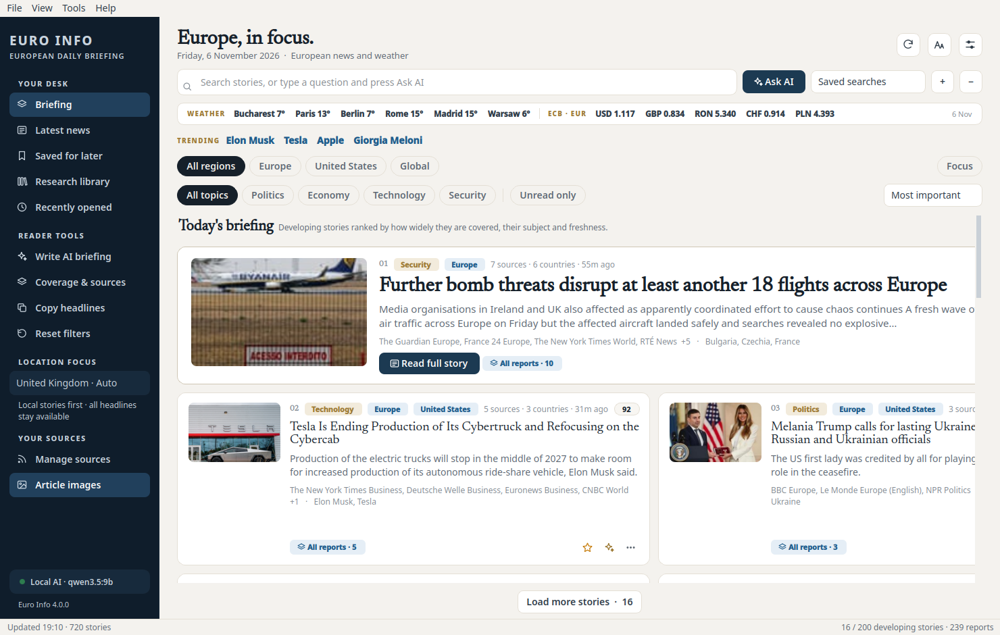
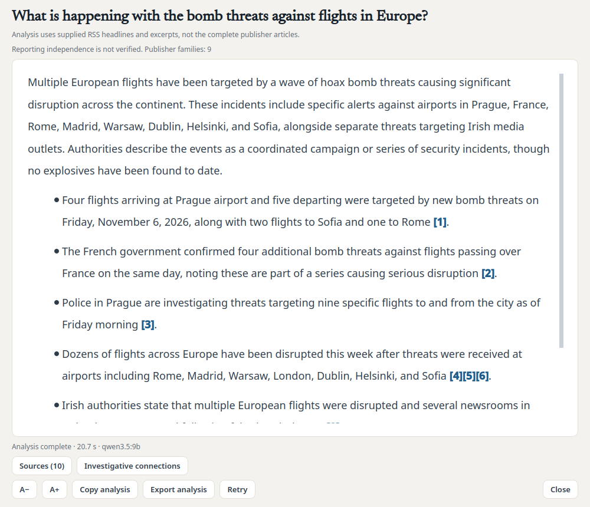
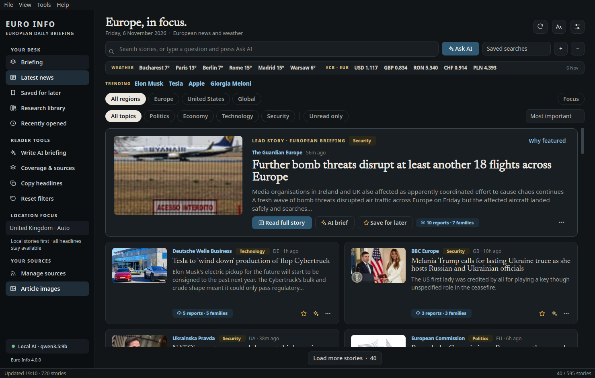
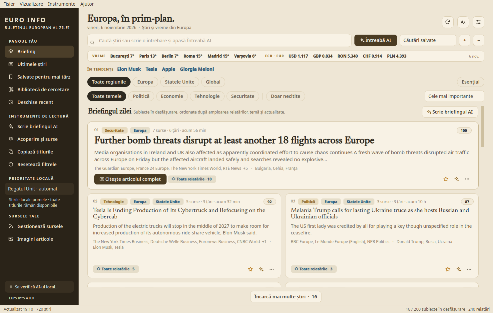

<div align="center">


# Euro Info

### All of Europe. The US news that matters. Ranked by what's important.
**A fast, private news desk for Windows and Linux, with an AI analyst that runs on your own computer.**

[](https://github.com/zmardanian/euro-info/releases/latest)
[](https://github.com/zmardanian/euro-info/actions/workflows/ci.yml)


[](LICENSE)

[**Download for Windows**](https://github.com/zmardanian/euro-info/releases/latest) ·
[**Download for Linux**](https://github.com/zmardanian/euro-info/releases/latest) ·
[Documentation](docs/README.md)



</div>

---

## Your morning briefing, already sorted

Euro Info reads **92 trusted sources**, from Brussels, Berlin, Paris, Warsaw, Kyiv and Bucharest to Washington,
then groups every report about the same event into one **developing story** and ranks it by how widely it is
covered, what it is about and how fresh it is. No algorithmic feed and no engagement bait: just what matters,
first, with the reasons one hover away.

| | |
|---|---|
| 🇪🇺 **All of Europe** | EU institutions and national desks in 23 countries, including Ukraine, the Baltics and the Balkans |
| 🇺🇸 **The US that matters** | Washington, the Fed, trade and big tech, while local US news stays out of your way |
| 📈 **Economy and technology** | Markets, central banks, AI, chips, Linux and science |
| 🔥 **Trending** | Subjects whose share of coverage is suddenly rising, one click to filter |
| 🎯 **Focus mode** | Hides sport, celebrity, lifestyle and local crime |
| 🔔 **Alerts** | A notification when your saved searches get new stories |

## Ask the news anything

Type a question and press **Ask AI**. Euro Info finds the most relevant reports and a local model, such as
Qwen3.5 through [Ollama](https://ollama.com), answers with **numbered citations** you can open. Or press
**Write AI briefing** for Europe, the United States, markets, technology and what to watch, each point sourced.

<div align="center"></div>

Everything runs on your computer. No account, no tracking, and your questions never leave your machine.

## Made for reading

<div align="center">


</div>

- Three themes (Standard, Warm paper, Soft night), compact and large-text layouts
- English, French, German, Italian, Romanian, Polish and Spanish, with optional private headline translation
- Research library: notes, tags, reading history, Markdown and CSV export
- Built-in reader, keyboard navigation (J/K, Ctrl+K, Ctrl+Enter) and a KDE Plasma widget
- Instant: the page redraws in milliseconds and the window opens in a fraction of a second

## Install

**Windows:** run `Euro-Info-4.0.0-windows-x64-setup.exe` (no administrator rights needed), or unzip the
portable version.

**Linux:**
```sh
tar --zstd -xf Euro-Info-4.0.0-x86_64.tar.zst && Euro-Info.AppDir/install.sh
```

For AI features, install [Ollama](https://ollama.com); the app offers to download the model for you.
Details: [Install](docs/install.md) · [Local AI](docs/local-ai.md).

## Documentation

[User guide](docs/user-guide.md) · [How ranking works](docs/ranking.md) · [Privacy](docs/privacy.md) ·
[Sources](docs/sources.md) · [Development](docs/development.md) · [Changelog](CHANGELOG.md)

<sub>Euro Info shows headlines and excerpts from publishers' public feeds and links to the original articles.
Inclusion of a source is not an endorsement; ranking signals are not reliability scores.</sub>

## License

Euro Info is free and open source under the [MIT License](LICENSE): use it, change it and share it, keeping the copyright notice. The bundled Newsreader font uses the SIL Open Font License.
